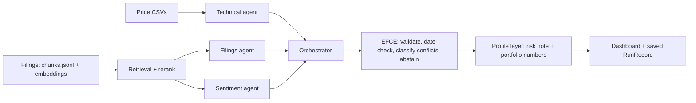

# VibeFinance: architecture

VibeFinance turns market data and company filings into cited, personalised signals for a retail investor. Three agents run in parallel; a deterministic layer (EFCE) then checks every claim before anything is shown. Evaluation numbers are in `RESULTS.md`; this document describes the design.

## Data flow

## Components

**Agents** (`src/agents`). Each returns a structured `Finding` with typed claims (entity, metric or event, period, direction, claim type factual / inferred / analytical, evidence ids, confidence).
- Technical: 20-trading-day return and volume z-score from the price files.
- Sentiment: a word-list score over retrieved passages (a computed `inferred` claim, not a language-model judgment).
- Filings: retrieves passages from the TCS annual report, press release and earnings-call transcript and extracts claims. It uses the local model (Ollama llama3.2) and falls back to deterministic quote extraction when the model output is unusable.

**Orchestrator** (`src/agents/orchestrator.py`). Runs the three agents in parallel with a timeout (default 240 s). A bad output or crash gets one retry; a timeout does not. A failed agent becomes a `Finding` with status `failed` and an error, so the failure is visible rather than silent.

**Retrieval** (`src/rag`). 927 chunks of TCS documents, embedded with nomic-embed-text, with a rerank step. Every passage carries an evidence id (`doc:<doc>:p<page>:c<chunk>`), its document, page and publication date. Only documents dated on or before the chosen as-of date are retrievable, so the system cannot look ahead. Price evidence ids are `px:<SYMBOL>:<date>`.

**Injection guard.** Retrieved text is treated as data, never as instructions. A passage that looks like an instruction is kept out of the model prompt and a limitation is recorded in the finding. It has been tested only on synthetic injected text.

**EFCE: Evidence and Conflict Resolution Engine** (`src/efce`). A rule layer after the agents; it uses no model.
- Rejects claims citing unknown evidence ids (`unknown_evidence_id`) and claims with no evidence (`missing_evidence`).
- Rejects sources dated after the as-of date (`source_after_as_of`) and stale sources (`stale_source`): price evidence older than 7 days, documents older than 540 days.
- Classifies conflicts between claims on the same entity and metric: different period strings give `temporal_difference`; the same period with opposite directions, both factual, gives `factual_contradiction`; anything else is `analytical_disagreement`. Both sides are always kept; EFCE never picks a winner.
- Abstains when evidence is missing instead of producing an uncited statement.
- Run status is one of `failed`, `abstained_or_limited`, `conflict_unresolved`, `degraded`, `complete`.

**Investor profiles** (`src/portfolio`). Stored profiles (risk preference, horizon, position and sector limits, holdings) in SQLite. The profile layer adds portfolio numbers (weights, sector weights, concentration, limit breaches) and a risk note to a finished run. It never changes signals, findings, citations or EFCE output, which is why the same market input gives different risk guidance but identical facts. Profiles and holdings are synthetic: conservative limits are 30% per position and 40% per sector, aggressive 35% and 60%.

**Dashboard** (`app.py`, Streamlit). Shows signals with confidence labelled as heuristic, claims with their cited source passages, EFCE status, conflicts, rejections and abstentions, the portfolio section for the selected synthetic profile, and per-session metrics. It runs the same agents and EFCE as the command line.

## Degraded-data behaviour

| Situation | What the system does |
|---|---|
| Price file missing | Technical finding reports missing prices; no price claim is made |
| No filings for the symbol or date | Filings finding reports missing documents; EFCE abstains |
| Agent times out or crashes | Finding marked `failed` with the error; run status reflects it |
| Agent output malformed | One retry, then a failed finding |
| Cited id does not exist | Claim rejected with `unknown_evidence_id` |
| Source too old or after the as-of date | Claim rejected with `stale_source` or `source_after_as_of` |
| Agents disagree | Conflict classified, both sides kept, status `conflict_unresolved` where applicable |

## Metrics logged per run

`latency_ms_<agent>`, `end_to_end_ms`, `agents_complete`, `citation_pass_rate`, plus `hhi`, `portfolio_breaches` and `portfolio_total_value` when a profile is applied. Every run is saved as a `RunRecord` (signals, findings, EFCE result, metrics, configuration).

## Evaluation design

13 labelled scenarios were committed before any baseline ran (4963150) and the scoring functions were committed before any baseline code existed (0b26b9d). Four systems are compared on the same scenarios: P (agents + EFCE), B1 (agents, present every claim), B2 (agents, majority vote), B0 (single agent, single model call). P, B1 and B2 share one agent run per scenario, so they differ only in synthesis. A 36-claim hand audit checks whether cited text supports each claim. Results, disclosed post-hoc changes and limitations are in `RESULTS.md`.

## Known limits

Sentiment is a word list; confidence values are heuristic, not calibrated. Only TCS documents are ingested. Profiles and holdings are synthetic. The scenario labels were written from EFCE's own rules, so P's perfect score is not independent evidence. The question box in the dashboard is recorded but does not change retrieval. See `RESULTS.md` for the full list.
